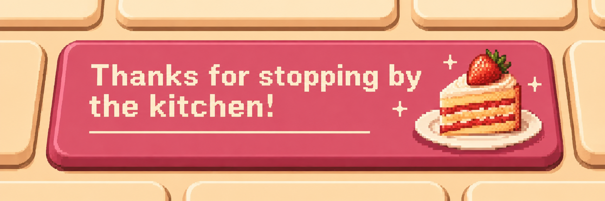

  

### welcome to my corner of the internet.

A rotating menu of software projects, research, and experiments in progress.

 

<a href="#-selected-projects">PROJECTS</a> &nbsp; / &nbsp;
<a href="#-technical-stack">TECH STACK</a> &nbsp; / &nbsp;
<a href="#-currently-in-development">CURRENT WORK</a> &nbsp; / &nbsp;
<a href="#-connect">CONNECT</a>

  

 

---

 

## 01 / about

I'm a Computer Science and Data Science student at Rutgers University, interested in software engineering, data science, cybersecurity, and product design.

My experience spans embedded systems, AI security, data analytics, and full-stack development.

 

**Areas of interest**

- Software engineering and application development
- Data science, algorithms, and machine learning
- Cybersecurity and AI governance
- Embedded systems and autonomous robotics
- UI/UX and product design

  

---

 

## 02 / selected projects

A selection of technical projects and research.

 

### 01 — MICROMOUSE
**Embedded Systems / Robotics / Algorithms**

Autonomous maze-solving robots developed with Rutgers Micromouse.

<b>View technical details</b>

 

**Overview**

Development and testing of autonomous robots designed to navigate a 16×16 maze.

**Technical work**
- ESP32-S3 firmware development
- Sensor integration and calibration
- Motor control and encoder feedback
- Floodfill maze exploration
- Dijkstra-based path planning
- Bluetooth telemetry and debugging

**Technologies:** C, C++, ESP32, Git

 

### 02 — CHEFFY
**Full-Stack Development / Product Design**

A social platform for people who cook, bake, and create drinks at home.

<b>View project details</b>

 

**Overview**

A social application focused on documenting and sharing homemade food.

**Features**
- Food photography and posts
- Ratings and reviews
- Ranking homemade creations
- Following friends
- Collaborative posts

**Focus:** Application development, UI/UX, product design

 

### 03 — STREAMING ALGORITHMS
**Research / Algorithms / Data Science**

Research on memory-efficient approximate frequency estimation.

<b>View research details</b>

 

**Overview**

Implemented and evaluated modifications to the Space-Saving algorithm for streaming data.

**Technical work**
- Algorithm implementation in C
- Approximate frequency estimation
- Memory-efficient data processing
- Performance and accuracy evaluation

**Technologies:** C, Algorithms, Data Structures

 

### 04 — AI & MACHINE LEARNING
**Machine Learning / Neural Networks**

Experiments involving biologically inspired learning algorithms and spiking neural networks.

<b>View technical details</b>

 

**Topics**
- Leaky Integrate-and-Fire neurons
- Hebbian learning
- Oja's learning rule
- Spike-Timing-Dependent Plasticity
- Feedforward spiking neural networks

**Technologies:** Python, NumPy

  

---

 

## 03 / technical stack

 

**Programming Languages**

 

**Frameworks & Tools**

 

**Technical Focus**

`Software Engineering` · `Data Science` · `Cybersecurity` · `Machine Learning` · `Embedded Systems` · `UI/UX`

  

---

 

## 04 / currently in development

 

| Project | Focus |
|:---|:---|
| **Micromouse** | Firmware development, navigation algorithms, and robotics testing |
| **CHEFFY** | Application development and product design |
| **AI / ML** | Neural networks and learning algorithms |
| **Cybersecurity** | AI security, governance, and risk management |

  

---

 

## 05 / connect

 

  

Open to collaboration on software engineering, data science, cybersecurity, and design projects.

  

---

 

